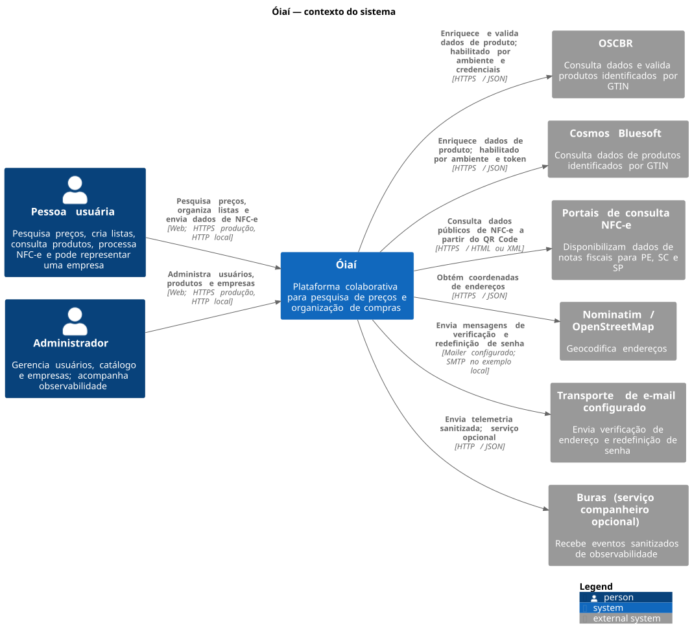
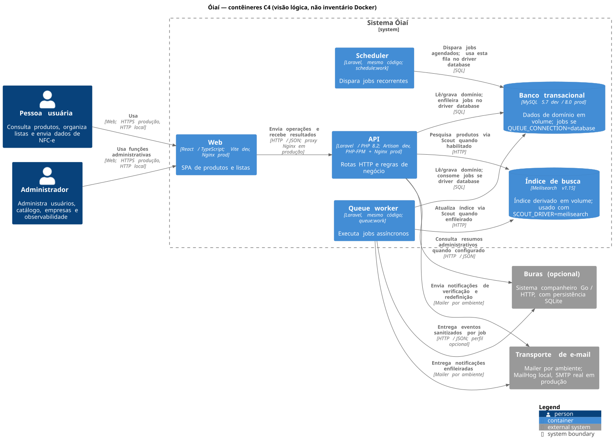

# Visão geral da arquitetura

## Contexto do sistema

O diagrama mostra os perfis e sistemas vizinhos sem expor componentes de
implementação. O ator administrador é sustentado pelo middleware `role:admin`
nas rotas administrativas. Representantes de empresas usam as rotas como
usuários autenticados comuns e não formam um papel de autenticação separado.

OSCBR, Cosmos, portais SEFAZ e Nominatim têm clientes ativos no código; o uso
dos provedores de produto depende de credenciais e configuração. O transporte
de e-mail é configurável e a identidade do provedor depende do ambiente. Buras
é um serviço companheiro implementado no monorepo, ativado opcionalmente pelo
perfil Compose, não um fornecedor terceiro.

O webhook de alertas do Buras não aparece como integração atual: sua URL é
configurável e vazia por padrão. Redis, AWS/S3, Meilisearch, MySQL, Web, API,
worker e scheduler também não aparecem nesta visão; são infraestrutura,
contêineres ou opções de configuração documentadas na visão abaixo ou nos ADRs.
Não há no código atual evidência de outros provedores de dados ou regiões NFC-e
além dos indicados no diagrama.

Fonte: [contexto.puml](contexto.puml). Perfis e integrações são rastreáveis em
`apps/api/routes/api.php`, `apps/api/app/Http/Middleware/EnsureUserHasRole.php`,
`apps/api/app/Services/Product/Providers/`, `apps/api/app/Services/NFCe/`,
`apps/api/app/Services/Geolocation/GeolocationService.php`,
`apps/api/app/Notifications/`, `apps/api/config/services.php` e
`apps/api/.env.example`; a relação opcional com Buras está em
`apps/api/app/Services/BurasReporter.php`, `apps/buras/README.md` e
`docker-compose.yml`.

## Visão de contêineres C4

O fonte editável está em [containers.puml](containers.puml). Nesta visão, um
contêiner C4 é uma parte executável ou um armazenamento lógico, não um
container/imagem Docker. `API`, `Queue worker` e `Scheduler` são processos
separados que executam o mesmo código Laravel (`apps/api`) com comandos
diferentes; não são microsserviços independentes.

O diagrama combina os ambientes com diferenças materiais anotadas: MySQL 5.7
local e 8.0 em produção, Vite local e Nginx para servir o build Web em produção,
Artisan local e PHP-FPM/Nginx para a API em produção. MySQL guarda a fila quando
`QUEUE_CONNECTION=database`; com `sync`, jobs executam no processo chamador. O
Compose local inclui MailHog, mas a API só o usa se `MAIL_HOST` apontar para ele;
em produção o mailer é configurado no ambiente. phpMyAdmin é ferramenta local
de administração do banco, omitida do fluxo lógico da aplicação.

As relações com OSCBR, Cosmos, portais SEFAZ e Nominatim já estão detalhadas na
visão de contexto; não são repetidas nesta visão para manter o foco nos
processos e armazenamentos executáveis. Meilisearch, MySQL, fila Laravel, e-mail
e Buras são mostrados aqui conforme sua execução/configuração nos Compose e nos
arquivos de ambiente.

Buras aparece como sistema companheiro independente e opcional, conforme seu
perfil Compose e ciclo de release separados. Veja [diagramas como código](diagrams/README.md)
para convenções e geração local.

## Responsabilidades

- **API**: autenticação, autorização, regras de negócio, persistência, processamento de NFC-e, busca e jobs;
- **Web**: interface do usuário, navegação, formulários e consumo dos contratos HTTP;
- **MySQL**: fonte de verdade transacional;
- **Meilisearch**: índice derivado para busca textual, fuzzy, prefixos e ranking;
- **Queue/Scheduler**: processamento assíncrono e tarefas periódicas;
- **Buras**: eventos sanitizados, checagens, painel e alertas de integrações.

O índice de busca pode ser apagado e reconstruído a partir do MySQL. Ele não substitui o banco transacional.

## Inventário baseado no repositório

Os elementos abaixo estão presentes no código ou nas configurações atuais. A
presença de um serviço no Compose não significa que ele seja obrigatório em
todos os ambientes; itens opcionais e configurações dependentes do ambiente
estão identificados.

| Elemento | Estado e papel | Evidência no repositório |
| --- | --- | --- |
| Pessoa usuária e administrador | Atores inferidos pelas rotas públicas de registro/login e pelo grupo administrativo protegido por Sanctum e role | `apps/api/routes/api.php`, `apps/api/app/Http/Controllers/AdminBurasDashboardController.php` |
| Web React/TypeScript | SPA servida pelo container `oiai-front` local e `web` em produção; cliente HTTP centralizado | `apps/web/package.json`, `apps/web/src/lib/api.ts`, `docker-compose.yml`, `docker-compose.prod.yml` |
| API Laravel | Aplicação HTTP; rotas, autenticação, regras de domínio e health check | `apps/api/routes/api.php`, `apps/api/routes/web.php`, `apps/api/app/Http/Controllers/HealthController.php`, `docker-compose.yml` |
| Worker Laravel | Container separado executando `php artisan queue:work` local e em produção; execução de jobs depende de `QUEUE_CONNECTION` | `docker-compose.yml`, `docker-compose.prod.yml`, `apps/api/config/queue.php`, `apps/api/.env.example` |
| Scheduler Laravel | Container separado executando `php artisan schedule:work`; tarefas registradas no Kernel | `docker-compose.yml`, `docker-compose.prod.yml`, `apps/api/app/Console/Kernel.php` |
| MySQL | Banco transacional persistido em volume; MySQL 5.7 local e 8.0 em produção | `apps/api/config/database.php`, `apps/api/.env.example`, `docker-compose.yml`, `docker-compose.prod.yml` |
| Meilisearch | Serviço de busca textual; Scout pode usar o driver `database` por padrão na configuração, mas o `.env.example` e os Compose configuram Meilisearch | `apps/api/config/scout.php`, `apps/api/.env.example`, `apps/api/app/Services/Product/MeilisearchProductSearch.php`, `docker-compose.yml`, `docker-compose.prod.yml` |
| Fila persistente | Exemplo local configura driver `database`; `config/queue.php` tem fallback `sync`. O storage efetivo é determinado por `QUEUE_CONNECTION` do ambiente | `apps/api/.env.example`, `apps/api/config/queue.php`, `apps/api/app/Console/Kernel.php` |
| Mail/SMTP | Notificações Laravel dependem de mailer configurável; MailHog está apenas no Compose local, produção injeta configuração de ambiente | `apps/api/config/mail.php`, `apps/api/app/Notifications/VerifyEmailNotification.php`, `apps/api/app/Notifications/ResetPasswordNotification.php`, `docker-compose.yml` |
| Buras | Serviço Go com API HTTP e SQLite em volume; perfil Compose opcional, recebe telemetria sanitizada da API | `apps/buras/README.md`, `apps/buras/internal/buras/store.go`, `apps/api/app/Services/BurasReporter.php`, `apps/api/app/Jobs/Telemetry/SendBurasEvent.php`, `docker-compose.yml`, `docker-compose.prod.yml` |
| OSCBR e Cosmos | Provedores externos de enriquecimento de produtos, condicionados à configuração/ativação do fluxo | `apps/api/app/Services/Product/Providers/OscbrProductDataProvider.php`, `apps/api/app/Services/Product/Providers/CosmosProductDataProvider.php`, `apps/api/app/Jobs/ProductDataSearchJob.php`, `docs/architecture/external-services-and-telemetry.md` |
| SEFAZ/NFC-e | Portais externos chamados pelos providers de Pernambuco, Santa Catarina e São Paulo | `apps/api/app/Services/NFCe/PernambucoNFCeProvider.php`, `apps/api/app/Services/NFCe/SantaCatarinaNFCeProvider.php`, `apps/api/app/Services/NFCe/SaoPauloNFCeProvider.php`, `apps/api/app/Jobs/ProcessInvoiceJob.php` |
| Nominatim/OpenStreetMap | Geocodificação externa de endereços | `apps/api/app/Services/Geolocation/GeolocationService.php`, `apps/api/config/services.php`, `apps/api/app/Jobs/GeocodeScheduleJob.php` |
| Webhook de alertas Buras | Integração opcional configurada por `BURAS_ALERT_WEBHOOK_URL`; ausência de URL não impede armazenar alertas | `apps/buras/README.md`, `apps/buras/internal/buras/config.go`, `apps/buras/internal/buras/worker.go` |

### Fora do escopo implementado

- Redis aparece como driver possível no Laravel, mas o Compose atual não sobe
  Redis; não é uma dependência confirmada do deployment padrão.
- AWS/S3, broadcasting Pusher e outros mailers aparecem como opções de
  configuração Laravel, sem evidência de uso obrigatório no Compose atual.
- Réplicas do Buras, armazenamento SQLite compartilhado entre hosts e um
  serviço externo de monitoramento são possibilidades futuras descritas no
  ADR 0005, não elementos implantados pelo Compose deste repositório.
- Domínios, limites de confiança e integrações habilitadas em produção variam
  com secrets/variáveis da VPS e não podem ser determinados apenas pelos arquivos
  versionados.

## Documentos relacionados

- [Arquitetura da API](api.md);
- [Arquitetura do Web](frontend.md);
- [Decisões arquiteturais](decisions/);
- [Buras](../../apps/buras/README.md).
